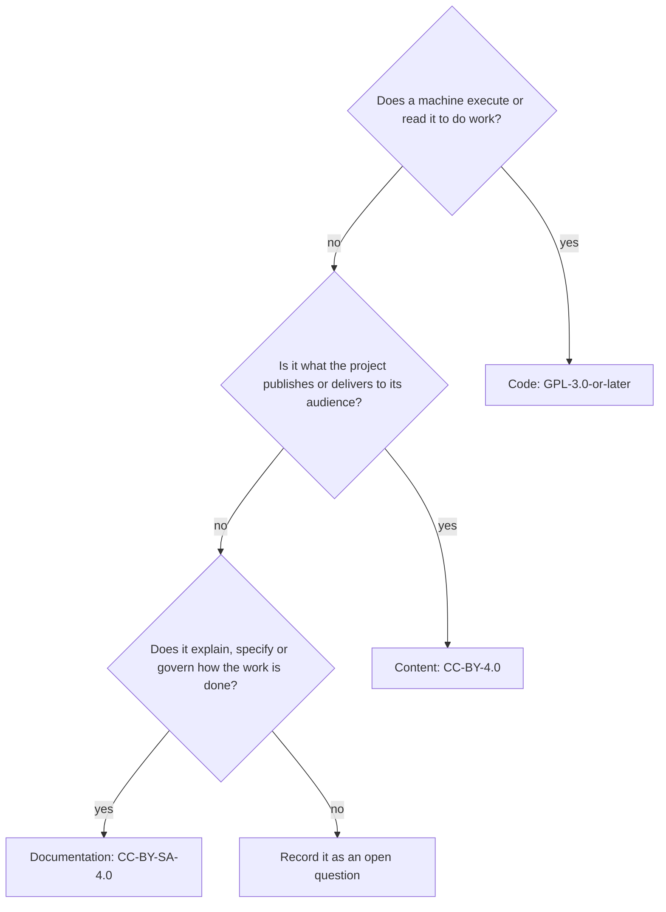

# Decision: Licensing for Code, Documentation and Content

Version: 0.1.0
Status: Accepted

## Decision

Vishpala licenses its own work in three categories, each under one default licence:

| Category | Licence | SPDX identifier |
| --- | --- | --- |
| Code | GNU General Public License v3.0 or later | `GPL-3.0-or-later` |
| Documentation | Creative Commons Attribution-ShareAlike 4.0 International | `CC-BY-SA-4.0` |
| Content | Creative Commons Attribution 4.0 International | `CC-BY-4.0` |

This replaces AGPL-3.0-or-later as the default for new work. It applies to uc-automa from its first commit and to each repository as it migrates. Existing repositories keep their current licences until then.

## Context

Licences across the repositories have been inconsistent: sat is AGPL-3.0-or-later, Balise's software is GPL-3.0-or-later with its demonstration content under CC-BY-4.0, and several repositories have no `LICENSE` file at all. The new automa needs one clear default for each kind of work.

The code licence follows the GNU GPL family used by Linux. The kernel itself is GPL-2.0-only <a id="cite-kernel-nd"></a>[(The kernel development community, n.d.)](#ref-kernel-nd), but version 3 is chosen here because it adds an explicit patent grant and protection against locked-down hardware, is compatible with Apache-2.0 dependencies, and matches what Balise already uses <a id="cite-fsf-2007"></a>[(Free Software Foundation, 2007)](#ref-fsf-2007). The AGPL's network clause adds little for tools that run on the user's own machine.

The GPL was written for software and speaks of source code, so it fits prose poorly. Documentation therefore takes the Creative Commons equivalent of copyleft, CC-BY-SA-4.0, under which derivatives stay open <a id="cite-cc-nd-b"></a>[(Creative Commons, n.d.-b)](#ref-cc-nd-b). Content takes CC-BY-4.0, which asks only for attribution, so the people it is made for can adapt it freely <a id="cite-cc-nd-a"></a>[(Creative Commons, n.d.-a)](#ref-cc-nd-a).

## The three categories

### Code

Code is anything a machine executes or reads to do work.

It includes source code, scripts, tests and their fixtures, build and package definitions such as `pyproject.toml`, schemas, configuration files, and templates that generate code or configuration. A file that mixes code and explanation, such as Python with docstrings, is code.

### Documentation

Documentation is writing about the work: it explains, specifies or governs how software, processes and projects work.

It includes READMEs, guides, directives, decision records, references, roadmaps, changelogs, process documents and document templates. Its readers are the people who build, use, maintain or evaluate the work.

### Content

Content is what a project exists to publish or deliver to its audience.

It includes the emergency procedures in a Balise site, articles on a website, items held in a SAT archive, and demonstration material. Its readers are the audience the project serves, not the people who maintain it.

## Telling documentation from content

One question separates them: is this about the work, or is it what the work delivers?



A second check confirms the answer: would it still be worth publishing if the software and tooling around it disappeared? Content usually would be; documentation usually would not.

| Example | Category | Why |
| --- | --- | --- |
| `lib/uc_automa/` source files | Code | Executed |
| `schemas/automa-config.schema.yaml` | Code | Read by tools to validate |
| `.gitattributes`, `.editorconfig` | Code | Read by tools to do work |
| uc-automa directives and guides | Documentation | Govern and explain how work is done |
| A repository's `README.md` and `CHANGELOG.md` | Documentation | About the work |
| `en-ca/templates/directive.md` | Documentation | A skeleton for writing documentation |
| Balise emergency procedures | Content | What the site delivers to municipalities |
| Articles on a website | Content | What the site publishes |
| Items in a SAT archive | Content | What the archive exists to hold |
| Code samples inside a guide | Documentation | Part of the guide; see the compatibility note below |

## What these defaults do not cover

- **Client content.** A client's own material is the client's, and the client chooses its licence. CC-BY-4.0 is the default only for content Vishpala authors, such as demonstrations.
- **Third-party material.** Anything taken from elsewhere keeps its own licence: vendored files, quoted passages, images and dependencies.
- **Licence texts.** The texts of the GPL and the Creative Commons licences are published by their authors under their own terms and are copied verbatim, never modified.
- **Contributions from others.** Relicensing existing work from AGPL-3.0-or-later is possible for work Christopher Steel wrote alone. Anything with other contributors needs their agreement first.

## Compatibility

The categories can borrow from each other in one direction. Creative Commons has declared CC-BY-SA-4.0 one-way compatible with GPL-3.0 <a id="cite-cc-nd-c"></a>[(Creative Commons, n.d.-c)](#ref-cc-nd-c), and the Free Software Foundation lists CC-BY-4.0 as compatible with GPL-3.0 <a id="cite-fsf-nd"></a>[(Free Software Foundation, n.d.)](#ref-fsf-nd). So a code sample from a guide, or a passage of content, can be adopted into GPL-3.0-or-later code. The reverse is not true: GPL code cannot be relicensed into documentation or content without the author's permission.

## How licences are marked

Licences follow the REUSE convention <a id="cite-fsfe-nd"></a>[(Free Software Foundation Europe, n.d.)](#ref-fsfe-nd), the same practice the Linux kernel uses: full licence texts in one folder, and an SPDX identifier <a id="cite-spdx-nd"></a>[(SPDX Workgroup, n.d.)](#ref-spdx-nd) for every file.

```text
uc-automa/
├── LICENSES/
│   ├── GPL-3.0-or-later.txt
│   ├── CC-BY-SA-4.0.txt
│   └── CC-BY-4.0.txt
└── REUSE.toml       which licence applies to which paths
```

```toml
# REUSE.toml (illustrative)
version = 1

[[annotations]]
path = ["lib/**", "tests/**", "schemas/**", "pyproject.toml", ".gitattributes", ".editorconfig"]
SPDX-FileCopyrightText = "Christopher Steel"
SPDX-License-Identifier = "GPL-3.0-or-later"

[[annotations]]
path = ["en-ca/**", "README.md", "CHANGELOG.md", "ROADMAP.md", "CONTRIBUTING.md"]
SPDX-FileCopyrightText = "Christopher Steel"
SPDX-License-Identifier = "CC-BY-SA-4.0"
```

Rules for marking:

- Path-based annotations in `REUSE.toml` set the licence for whole directories, so most files need no header of their own.
- A file that differs from its directory's default carries its own `SPDX-License-Identifier` line.
- A document's `dc:rights` must match the SPDX identifier that covers it, and a uc-automa check verifies that they agree.
- Each document ends with a License section built from the licence-block offering for its category.

## Consequences

- uc-automa offers three licence offerings, one per category, replacing the single AGPL offering in the layout drafts.
- The layout gains a `LICENSES/` folder and a `REUSE.toml` file at the root.
- The documents drafted on 2026-10-07 and 2026-10-09 declare AGPL-3.0-or-later and change to CC-BY-SA-4.0 when they are next revised.
- Existing repositories are not relicensed in place; each adopts these defaults when it migrates.

## Open questions

- [ ] Are uc-radar entries content, as the published output of Universal Cake, or documentation? This decision suggests content.
- [ ] Is the Universal Cake evaluation metrics document content or documentation? It specifies how evaluation is done, which suggests documentation.
- [ ] Should repositories keep a root `LICENSE` file, holding the code licence for forges that look for one, alongside `LICENSES/`?

## References

This list was compiled without web access on 2026-10-09. Entries marked (unverified) give a URL from memory that should be checked before relying on it.

<a id="ref-cc-nd-a"></a>Creative Commons. (n.d.-a). *Attribution 4.0 International (CC BY 4.0)*. Retrieved October 9, 2026, from https://creativecommons.org/licenses/by/4.0/ [↩](#cite-cc-nd-a)

<a id="ref-cc-nd-b"></a>Creative Commons. (n.d.-b). *Attribution-ShareAlike 4.0 International (CC BY-SA 4.0)*. Retrieved October 9, 2026, from https://creativecommons.org/licenses/by-sa/4.0/ [↩](#cite-cc-nd-b)

<a id="ref-cc-nd-c"></a>Creative Commons. (n.d.-c). *Compatible licenses*. Retrieved October 9, 2026, from https://creativecommons.org/share-your-work/licensing-considerations/compatible-licenses/ (unverified) [↩](#cite-cc-nd-c)

<a id="ref-fsf-2007"></a>Free Software Foundation. (2007). *GNU General Public License* (Version 3). https://www.gnu.org/licenses/gpl-3.0.html [↩](#cite-fsf-2007)

<a id="ref-fsf-nd"></a>Free Software Foundation. (n.d.). *Various licenses and comments about them*. Retrieved October 9, 2026, from https://www.gnu.org/licenses/license-list.html [↩](#cite-fsf-nd)

<a id="ref-fsfe-nd"></a>Free Software Foundation Europe. (n.d.). *REUSE specification*. Retrieved October 9, 2026, from https://reuse.software/spec/ [↩](#cite-fsfe-nd)

<a id="ref-spdx-nd"></a>SPDX Workgroup. (n.d.). *SPDX license list*. Retrieved October 9, 2026, from https://spdx.org/licenses/ [↩](#cite-spdx-nd)

<a id="ref-kernel-nd"></a>The kernel development community. (n.d.). *Linux kernel licensing rules*. The Linux Kernel documentation. Retrieved October 9, 2026, from https://docs.kernel.org/process/license-rules.html (unverified) [↩](#cite-kernel-nd)

## Changelog

| Version | Date | Status | Notes |
| --- | --- | --- | --- |
| 0.1.0 | 2026-10-09 | Accepted | Initial decision: three categories and their licences, the documentation versus content test, REUSE marking |

## License

This document, *Decision: Licensing for Code, Documentation and Content*, by **Christopher Steel**, with AI assistance from **Claude Opus 5.5 (Anthropic)**, is licensed under the [Creative Commons Attribution-ShareAlike 4.0 International License](https://creativecommons.org/licenses/by-sa/4.0/).
