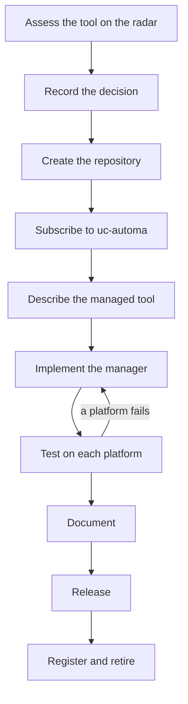

# Creating an OSAT Manager Repository

Version: 0.3.0
Status: Accepted

## Summary

A new OSAT manager goes through ten stages, from a radar assessment of the tool it manages to its first release, and each stage ends at a checkable gate. The repository is created fresh, receives everything shared by subscribing to uc-automa's offerings, and copies nothing by hand. Its layout type is `osat-manager`, described in the directory guide <a id="cite-steel-2026a"></a>[(Steel, 2026a)](#ref-steel-2026a).

## What an OSAT manager is

An OSAT manager is a governed tool that installs another tool into user space and manages its versions there, with no elevated privilege, no system package manager and no compiler. The contract below is drawn from osat-manager-python, the first manager, which installs self-contained CPython runtimes and runs as `manage-python` <a id="cite-steel-2026c"></a>[(Steel, 2026c)](#ref-steel-2026c). Every manager meets the same contract, so a person who has used one can use them all.

| Capability | What it means |
| --- | --- |
| User-space install | Installs into the user's own directories; never needs administrator rights |
| Versions side by side | Several versions of the managed tool can be installed at once |
| Switching | One command makes a chosen version the active one |
| Aliases | A generic alias, such as `restic`, beside versioned ones, such as `restic-0.18`; any alias can be renamed |
| Protection | Installed versions are guarded against accidental modification |
| Nothing left behind | Uninstalling removes everything the manager owns, and a parent directory such as `~/.local/bin` only if the manager created it and it is now empty; a directory that holds anything else is never removed |
| Verified archive | Every download is verified before it is unpacked, and kept with the checksums and signature that verified it, so a version can be restored offline and re-checked |
| Self-install | The manager installs itself, so it works from any directory |
| Three platforms | Linux, macOS and Windows, with each platform's status stated honestly |

## Naming

| Thing | Pattern | Example |
| --- | --- | --- |
| Repository | `osat-manager-<tool>` | `osat-manager-restic` |
| Command | `manage-<tool>` | `manage-restic` |
| Python package | `osat_manager_<tool>` | `osat_manager_restic` |
| SAT sidecar | `.osat-manager-<tool>.assets/` | `.osat-manager-restic.assets/` |
| Documents before 1.0.0 | `<slug>-vX.Y.Z.md` | `using-manage-restic-v0.1.0.md` |
| Documents from 1.0.0 | `<slug>.md` | `using-manage-restic.md` |

`<tool>` is the managed tool's own name in lowercase, with hyphens for any spaces. The Python package uses underscores, because Python cannot import hyphens; everything else uses hyphens.

## Repository layout

The `osat-manager` layout extends `python-tool`, which extends `base`. `uc-automa check` compares the repository with it.

```text
osat-manager-<tool>/
├── README.md                     what it manages, install, platform status table
├── LICENSE                       from license-gpl-3-0-or-later
├── LICENSES/                     from the licence offerings
├── REUSE.toml                    seeded by reuse
├── CHANGELOG.md                  seeded by changelog
├── VERSION                       seeded by version-file
├── ROADMAP.md
├── CONTRIBUTING.md
├── CLAUDE.md                     ends with the claude-signpost block
├── .uc-automa.yaml               written once by uc-automa init
├── .uc-portage-state.yaml        written by uc-automa offerings apply
├── .osat-manager-<tool>.assets/
│   ├── archive.yaml
│   └── dc.yaml
├── .gitattributes                from line-endings
├── .editorconfig                 from editorconfig
├── .gitignore
├── pyproject.toml                the package and the manage-<tool> entry point
├── manager.yaml                  what is managed, from where, how it is verified
├── lib/
│   └── osat_manager_<tool>/
├── tests/
│   ├── unit/                     offline, run everywhere
│   └── e2e/
│       └── linux/                one directory per platform run
└── en-ca/
    └── docs/
        ├── README.md             generated by uc-automa docs index
        ├── guides/               using the manager
        └── decisions/            decisions for this manager only
```

## The process at a glance



## Assess the tool on the radar

Every manager starts with the tool it manages, so the tool is evaluated before any code is written. Write a uc-radar entry using the radar's entry template and the Universal Cake evaluation metrics <a id="cite-steel-2026d"></a>[(Steel, 2026d)](#ref-steel-2026d). Adding the entry to uc-radar goes through its own review; until then it is a draft.

The entry answers the questions a manager depends on:

- Does upstream publish prebuilt releases for Linux, macOS and Windows, and for which architectures?
- Does upstream publish checksums, and are they signed? With what key?
- Can the tool run from a user directory without installation or administrator rights?
- What licence does the tool carry, and does it allow keeping a verified archive?
- How often does upstream release, and how are versions named?

Gate: the tool is in the `trial` or `adopt` ring, or the entry explains why a manager is still wanted.

## Record the decision

Draft the decision to build the manager before the repository exists, outside any repository, such as in the hand-off folder for the work. It becomes `en-ca/docs/decisions/0001--<slug>-v0.1.0.md`, numbered within the repository, in the repository's first commit. It names the managed tool, the radar entry, the platforms targeted first, and anything this manager does differently from the contract.

Gate: the decision record is drafted.

## Create the repository

Create the repository fresh and empty, with no forge-generated files, so its first commit already conforms.

1. Create the local repository with `git init`. Creating it on a forge and pushing are Christopher Steel's decisions, taken separately.
2. Generate the repository's identifier with `uuidgen -r`.
3. Write `.osat-manager-<tool>.assets/archive.yaml` and `dc.yaml`.
4. Place the drafted decision record at `en-ca/docs/decisions/0001--<slug>-v0.1.0.md`, and commit it with the sidecar as the repository's first commit.

```yaml
# .osat-manager-<tool>.assets/archive.yaml
sat:role: "archive"
dc:identifier: "urn:uuid:<generated in step 2>"
dc:title: "osat-manager-<tool>"
dc:language: "en-CA"
dc:rights: "CC-BY-SA-4.0"
```

Gate: the first commit holds the sidecar and the decision record, and nothing else.

## Subscribe to uc-automa

Everything shared arrives from uc-automa by subscription; nothing is copied by hand. `init` writes `.uc-automa.yaml` once, with the subscriptions the osat-manager layout requires (uc-automa 0023); the repository owns the file from then on.

```sh
uc-automa init --repository osat-manager-<tool> --layout osat-manager
uc-automa offerings plan
uc-automa offerings apply
git add -A
git commit -m "Receive uc-automa offerings"
```

Gate: `uc-automa offerings plan` reports nothing to do.

## Describe the managed tool

Write `manager.yaml`, a declarative description of what the manager installs, where it comes from, how each download is verified, and what each platform needs. Keeping this in data rather than code means most managers differ only in this file, and a reviewer can check sources and verification without reading code.

```yaml
# manager.yaml (illustrative; every value comes from the radar entry)
tool:
  name: "<tool>"
  command: "manage-<tool>"
  upstream: "<upstream project URL>"
  license: "<SPDX identifier of the managed tool>"
versions:
  scheme: "semver"
  default_alias: "<tool>"
  versioned_alias: "<tool>-{major}.{minor}"
sources:
  release_url: "<release URL pattern with {version}, {os} and {arch}>"
  checksums_url: "<checksums file URL pattern>"
  signature_url: "<signature URL pattern, if upstream signs>"
verification:
  checksum: "sha256"
  signature: "<required, optional or unavailable>"
  keep_verified_archive: true
platforms:
  linux:   {arch: ["x86_64", "aarch64"], status: "planned"}
  macos:   {arch: ["x86_64", "arm64"],   status: "planned"}
  windows: {arch: ["x86_64"],            status: "planned"}
```

If upstream signs its checksums, pin its signing key by fingerprint, and confirm the fingerprint from two independent sources, such as upstream's documentation and the key server it names.

Gate: every source and verification field is filled from the radar entry, with no placeholders left.

## Implement the manager

Implement the contract in `lib/osat_manager_<tool>/`, reading `manager.yaml` for everything tool-specific, and expose it as a console-script entry point, which gives a native launcher on Windows and a script on Linux and macOS from one definition <a id="cite-pypa-nd"></a>[(Python Packaging Authority, n.d.)](#ref-pypa-nd).

- Standard library and `pathlib`, with no shell commands at runtime, so behaviour is the same on every platform. Tests may call other tools, such as `gpg`, to cross-check results.
- Shared behaviour comes from the shared manager package (uc-automa 0024): reading `manager.yaml` without PyYAML, finding it in an install or a checkout, and verifying OpenPGP signatures. Until that package exists, a manager carries its own copies, listed as known debt.
- A signature verifier is reviewed independently, by a reviewer who did not see it written, before any manager relying on it is tagged.
- Platform differences, such as install locations and alias launchers, are resolved in one module.
- Every download is verified with SHA-256 before it is unpacked, and against upstream's signature if upstream signs its checksums. The verified archive is kept.
- `manager.yaml` is read from the repository root through the shared data resolver, so the installed package carries it (uc-automa 0019).

Gate: `tests/unit/` passes offline.

## Test on each platform

Each platform has its own end-to-end run, and each run updates the platform status table. A platform is either verified end to end or stated as not yet verified; it is never assumed (uc-automa 0011).

| Platform | Where it runs | Record |
| --- | --- | --- |
| Linux | An Incus container restored to a clean snapshot before and after the run, as an ordinary user | `tests/e2e/linux/` |
| Windows | The Windows 11 virtual machine, reached through its built-in OpenSSH Server with key authentication, as an ordinary user, restored to a snapshot before each run | `tests/e2e/windows/` |
| macOS | Apple hardware, the only legitimate place to run macOS | `tests/e2e/macos/` |

```yaml
# The end-to-end scenario every platform runs
scenario:
  - "Install the manager into a clean user account"
  - "Install two versions of the managed tool side by side"
  - "Switch between them and confirm the active version"
  - "Rename an alias and confirm both forms resolve correctly"
  - "Attempt to modify an installed version and confirm it is protected"
  - "Remove a version, disconnect the network, and restore it from the verified archive"
  - "Uninstall the manager and confirm nothing is left behind"
```

A scenario run writes a record of every step beside its driver. Upstream files kept as test data, such as `SHA256SUMS`, keep their upstream names inside a zip file, because those names do not follow the naming directives.

Gate: every platform in `manager.yaml` is `verified` or has a stated reason it is not.

## Document

Write what a user needs, and nothing uc-automa already says.

- `README.md`: what the manager manages, how to install it, and the platform status table from testing.
- `en-ca/docs/guides/usage/using-manage-<tool>-v0.1.0.md`: every command, with examples.
- `ROADMAP.md`: what is planned, such as unverified platforms.
- `CHANGELOG.md`: the entry for the first release, under `[Unreleased]`.
- `uc-automa docs index`, to regenerate the documentation index.

Gate: `uc-automa check` passes.

## Release

The first release is 0.1.0. Until uc-automa provides the release ceremony, planned for uc-automa 0.2.0, a release is tagged by hand, and only with Christopher Steel's approval: a surgical commit that only rolls `CHANGELOG.md` to `## [0.1.0] - <date>`, then an annotated tag `v0.1.0` whose message names the repository and the version, as the directive `release/annotated-version-tags` requires. A manager reaches 1.0.0 when every platform in `manager.yaml` is verified and the full scenario passes on each (uc-automa 0011); its documents then drop the version from their filenames (uc-automa 0002).

Gate: the tag exists, approved.

## Register and retire

Make the new manager findable, and retire what it replaces.

1. Update the tool's radar entry to link to the manager.
2. Add the manager to the list of OSAT managers, wherever that list is kept (see open questions).
3. If the manager replaces an older `osat-fluent-<tool>-tool` repository, Christopher Steel adds a README notice naming the successor and archives the old repository, once the new repository is pushed, so the notice links to a real successor. It is not deleted or renamed, so every existing link and clone still works.

Gate: a person starting from the radar entry, the OSAT list or the old repository arrives at the new manager.

## Checklist

- [ ] Radar entry written for the tool, ring `trial` or `adopt`
- [ ] Decision record drafted outside the repository
- [ ] Repository created, first commit holding the sidecar and the decision record
- [ ] `uc-automa init` run, offerings applied and committed
- [ ] `manager.yaml` complete, with no placeholders
- [ ] Manager implemented; unit tests pass offline
- [ ] Linux, Windows and macOS each verified or stated as not yet verified
- [ ] README, guide, roadmap and changelog written; `uc-automa check` passes
- [ ] 0.1.0 tagged, with approval
- [ ] Radar entry linked, manager listed, any predecessor archived with a notice

## Open questions

- [ ] Where is the list of OSAT managers kept: in uc-automa, in uc-radar, or in its own repository?
- [ ] Is `osat` the right directory name inside each platform's per-user data location?

## References

<a id="ref-pypa-nd"></a>Python Packaging Authority. (n.d.). *Entry points specification*. Python Packaging User Guide. Retrieved October 7, 2026, from https://packaging.python.org/en/latest/specifications/entry-points/ [↩](#cite-pypa-nd)

<a id="ref-steel-2026a"></a>Steel, C. (2026a). *Directory guide* (Version 0.2.0) [Unpublished manuscript]. uc-automa. [directory-guide-v0.2.0.md](../repository/directory-guide-v0.2.0.md) [↩](#cite-steel-2026a)

<a id="ref-steel-2026c"></a>Steel, C. (2026c). *osat-manager-python* [Computer software]. GitHub. https://github.com/steelcj/osat-manager-python [↩](#cite-steel-2026c)

<a id="ref-steel-2026d"></a>Steel, C. (2026d). *uc-radar: Universal Cake radar entries and evaluation metrics* [Computer software]. GitHub. https://github.com/steelcj/uc-radar [↩](#cite-steel-2026d)

## Changelog

| Version | Date | Status | Notes |
| --- | --- | --- | --- |
| 0.3.0 | 2026-10-09 | Accepted | Findings from building osat-manager-restic: the decision drafted before the repository and placed in its first commit, nothing left behind, the shared manager package, pinned keys confirmed twice, independent review of a verifier, snapshot-based Linux runs and the Windows route, upstream names inside zips, the release tag rule, archiving after push |
| 0.2.0 | 2026-10-09 | Accepted | Revised to the foundation brief: uc-automa init and offerings instead of .automa.yaml and the interim file-fairy route, en-ca, the osat-manager layout, the three licences, by-hand tagging until the release ceremony, D11 settled; relicensed CC-BY-SA-4.0 |
| 0.1.0 | 2026-10-09 | Draft | Initial process: manager contract, naming, layout, ten stages with gates, interim route, checklist |

## License

This document, *Creating an OSAT Manager Repository*, by **Christopher Steel**, with AI assistance from **Claude Opus 5.5 (Anthropic)**, is licensed under the [Creative Commons Attribution-ShareAlike 4.0 International License](https://creativecommons.org/licenses/by-sa/4.0/).
