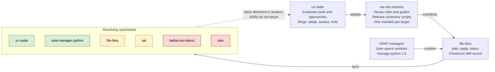

# Overview: SAT Development, Current State

Version: 0.1.0
Status: Draft

## Purpose and scope

SAT development already runs on a coherent system: sat-doc-automa holds the canonical conventions and scripts, file-fairy distributes them, and product repositories receive them. The system is unevenly applied, and its procedures for new repositories, test platforms and releases are not yet written down in one place.

This document records how things work today, as observed in the public repositories on 2026-10-07. It describes rather than prescribes. Findings are collected near the end as input for a separate improvement pass.

In scope: sat-doc-automa, uc-radar, file-fairy, osat-manager-python and the other OSAT Fluent tools, sat, satx, and balise-sos-demo. Out of scope for now: client hosting, and websites not yet in a public repository.

## The system at a glance

Conventions and scripts move one way, from sat-doc-automa through file-fairy into each repository. Nothing carries product decisions back to the radar.

Key: green means synced with a state file recorded; amber means a manifest exists but no sync record was seen; red means no manifest in the automa.

The radar decides what is adopted, the automa holds the canonical files, file-fairy distributes them on the runtimes the OSAT managers install, and the products receive them. Coverage is uneven: two targets show a sync record, two have a manifest but no record, and two have no manifest at all.

## Resources

Seven repositories carry the work, in three roles: governance (automa, radar), tooling (file-fairy, OSAT managers) and products (SAT, Balise).

### sat-doc-automa, the canonical source

sat-doc-automa [(Steel, 2026e)](#ref-steel-2026e) is the canonical home for style guides, formats, templates and automa across SAT, OSAT Fluent and Universal Cake. It holds:

- Automa under `en/docs/automa/`, per format, with `defaults/` for rules in force and `examples/` for chosen alternatives: markdown rules, AI collaboration, licence blocks, and the shared CLAUDE.md signpost block.
- Guides: five style guides (versioned documents, technical register, plain language, navigation and accessibility, APA 7) and the devops guides (Commit and Versioning Workflow v0-3-0, file-fairy Usage v0-1-0).
- Decision records under `en/docs/decisions/devops/`, including gh CLI for release asset publishing.
- The release ceremony scripts at the root: `bump-version.py`, `cut-release.py`, `publish-release.py`, `check-conformance.py`, `test_publish_release.py`, plus `normalize-metadata.py`.
- Eleven file-fairy manifests, `ff-manifest-<target>.yaml`, one per receiving repository.

It is deliberately structured as a SAT archive from its first commit, so it can become the first SAT archive with little rework.

### uc-radar, the decision gate

uc-radar [(Steel, 2026g)](#ref-steel-2026g) holds Universal Cake radar entries and the evaluation metrics. Entries sit under `en/docs/radar/` in rings `adopt/`, `assess/` and `hold/`, grouped by domain. Process documents live beside them: an evaluation lifecycle (v0-1-0), an entry template (v0-2-0) and a praxis evaluation prompt (v0-1-1). Metrics versions v0-3-1, v0-4-0-draft, v0-5-0-draft and v0-5-1 are all present. The current release is 0.2.4 (2026-09-29). It has received the shared zone from sat-doc-automa through file-fairy since 0.1.2 [(Steel, 2026h)](#ref-steel-2026h).

### file-fairy, the distribution mechanism

file-fairy [(Steel, 2026b)](#ref-steel-2026b) is a manifest-driven CLI with `plan`, `apply` and `status` verbs. It copies named groups of files from a source repository to a target on local disk and tracks drift by checksum in a per-target `.file-fairy-state.yaml`. Sync modes are `mirror` (the default), `seed_if_missing`, `overwrite` and `reference_only`. It also supports retraction (`state: absent`) and managed blocks inside files the target otherwise owns. It started as a radar entry, and it needs Python 3.8+ and PyYAML.

### OSAT managers, the runtimes

osat-manager-python [(Steel, 2026c)](#ref-steel-2026c), run as `manage-python`, installs self-contained CPython runtimes into user space without elevated privilege, a package manager or a compiler. It is at 1.0.x, verified end to end on Linux x86-64; the Windows aliases, `install.ps1` and macOS are not yet verified. It is the first of the OSAT collection to move from `-tool` installer to `-manager`. Siblings with manifests in the automa include the hugo, myrepos, rclone, restic, sat and wekan tools.

### sat, the current SAT line

sat [(Steel, 2026d)](#ref-steel-2026d) is Source Archive Tools: filesystem-first archive management with small standalone commands. Its README status reads `sat_version: 0.7.0`. It carries the content pipeline (metadata ingress, egress, transmog to MkDocs), `satlib`, and docs under `en/`. Tools live under `en/bin` and `en/lib`. Its README changelog records the tag drift of 0.4.1 to 0.4.3 that the current release workflow was written to prevent.

### satx, SAT in development

satx [(Steel, 2026f)](#ref-steel-2026f) is the development line. It already shows the newer design: a `.satx.assets` sidecar at the root, language-neutral `bin/` and `lib/`, language trees `en/`, `es/` and `fr/`, `venvs/.venvs.assets`, and a `satx-seed.tar.gz`. Its README is empty.

### balise-sos-demo, the first product site

balise-sos-demo [(Steel, 2026a)](#ref-steel-2026a) is the offline-first emergency procedures demonstration and the entry point of the Resilience Pack. It is an Eleventy build producing three copies from one build: installed web, a downloadable zip of about 170 KiB, and print. It is bilingual (`en/docs`, `fr-ca/docs`) with six ADRs, operator and editor guides, and a session log. It publishes with `npm run deploy:local` to an Incus web container on flow, without GitHub Actions (ADR-006). Its house rules under `en/docs/automa/` are described as synced from sat-doc-automa.

## The shared repository kit

A de facto standard repository already exists: the same root files recur across most repositories, delivered by file-fairy from sat-doc-automa.

| File or path | Role | Delivered how |
| --- | --- | --- |
| `VERSION` | Single source of the version | Seeded once, then owned by the repo (`seed_if_missing` is the documented example) |
| `CHANGELOG.md` | Repository changelog, Keep a Changelog format | Per repo |
| `ROADMAP.md` | Forward plan | Per repo |
| `CLAUDE.md` | AI collaboration signpost | Shared signpost block from `automa/claude-md/` |
| `LICENSE` | Licence text | Per repo; licence blocks from `automa/licenses/` |
| `bump-version.py` | Computes and writes the next version | Synced from automa, devops-scripts group |
| `cut-release.py` | Bump, roll changelog, surgical commit, tag, stop before push | Synced from automa |
| `publish-release.py` | Tarball, `SHA256SUMS`, optional GPG, via `gh` or a plain directory | Synced from automa |
| `check-conformance.py` | Lints markdown against house rules | Synced from automa |
| `test_publish_release.py` | Offline tests for the publish ceremony | Synced from automa |
| `normalize-metadata.py` | Metadata normalisation | Present in automa, uc-radar, osat-manager-python; not listed in the automa README |
| `.file-fairy-state.yaml` | Record of the last sync | Written by file-fairy in the target |
| `en/docs/` | Language-rooted documentation | Convention, plus synced devops guides and automa |

Per-document conventions ride on top: Dublin Core and `sat:` front matter, versioned filenames (the spec is `-vX.Y.Z` before 1.0.0 and no version in the filename from 1.0.0; most repositories currently use `-vX-Y-Z`), a changelog table in each document, and a License section built from the licence blocks.

## Procedures as practised

Only the release ceremony and the sync are written down. New repository and test platform setup are reconstructed here from what the repositories contain, and steps marked (inferred) need confirming.

### New repository

1. Create the repository on GitHub under steelcj and clone it locally (inferred).
2. Write a manifest `ff-manifest-<repo>.yaml` in sat-doc-automa naming the groups the repo receives.
3. Run `file-fairy plan`, then `file-fairy apply`, against the manifest.
4. Commit what arrived as its own commit, the receive-then-commit pattern in the file-fairy Usage guide; uc-radar records this as a changelog entry.
5. Add the repo's own `README.md`, `LICENSE`, `ROADMAP.md` and `en/docs/` content (inferred).

### Keeping a repository current

1. Change the canonical file in sat-doc-automa.
2. Run `file-fairy plan` per manifest to see `new`, `update` and `conflict` items.
3. Run `apply`; conflicts on `mirror` items are skipped unless `--force` is given.
4. Commit the received files in each target.

There is no single command that runs every manifest, so propagation depends on remembering which targets exist (inferred).

### Release

From the Commit and Versioning Workflow v0-3-0, the ceremony in four steps:

1. Write the changelog entries under `[Unreleased]`.
2. Run `cut-release.py`: bump, roll the changelog, surgical commit, tag, stop before push.
3. Push the commit and the tag.
4. Run `publish-release.py`: deterministic tarball, `SHA256SUMS`, optional GPG signature, published with `gh` or to a plain directory.

sat predates the synced kit and uses its own `bump-sat-version.py`.

### Test platforms

Three kinds are in use, each set up per project:

- Unit and offline tests in the repo root, run with `python3 test_*.py` (file-fairy, osat-manager-python, and the publish ceremony everywhere).
- End-to-end runs on Linux, such as `e2e_manage_python.py`, presumably inside Incus containers on flow (inferred).
- Windows 11 VM validation through `validate-windows.ps1` in osat-manager-python.

Balise adds `npm run check`: an offline link check and markdown conformance.

### Publishing a site

Balise builds with `npm run build` into `_site/` and deploys with `npm run deploy:local` to an Incus web container on flow.local. ADR-006 records the choice of self-hosted publishing without GitHub Actions. sat's README shows the older path: `archive-init.py` creating a MkDocs docs tree for chrissteel.com.

## Coverage matrix

Only uc-radar and osat-manager-python show the full kit plus a sync record. satx carries none of it, and Balise has the kit but no manifest in the automa.

| Repository | Kit scripts | VERSION and CHANGELOG | CLAUDE.md | LICENSE file | Sync state file | Manifest in automa | Docs root |
| --- | --- | --- | --- | --- | --- | --- | --- |
| sat-doc-automa | Source | Yes | Yes | No, per document | Not applicable | Not applicable | `en/docs/` |
| uc-radar | Yes | Yes | Yes | No | Yes | Yes | `en/docs/` |
| osat-manager-python | Yes | Yes | Yes | Yes | Yes | Old name only (`python-tool`) | `en/docs/` |
| file-fairy | Yes | Yes | No | No | No | Yes | `en/docs/` |
| balise-sos-demo | Yes | Yes | Yes | GPL-3.0 | No | No | `en/docs/`, `fr-ca/docs/` |
| sat | No, own `bump-sat-version.py` | Yes | `.claude/` only | AGPL-3.0 | No | Yes (`ff-manifest-sat`) | `en/` |
| satx | No | No | No | No | No | No | `en/`, `es/`, `fr/` |

Read from each repository's root listing on 2026-10-07. A state file absent from a listing may be gitignored rather than missing.

## Findings for the improvement pass

The largest gap is that decisions are made in product repositories and do not flow back to the radar. The rest are coverage and drift issues that the existing tooling can already fix.

| Area | Finding | Evidence |
| --- | --- | --- |
| Radar and practice | Tools in daily use are still in `assess` | Incus is in `assess/containers` but hosts Balise and the test platforms; Caddy is in `assess/webservers` despite scoring very high |
| Radar and practice | Product ADRs decide stack choices outside the radar | Balise ADR-001 (Eleventy) and ADR-006 (self-hosted publishing) have no matching radar entries seen |
| Radar and practice | Three radar locations | uc-radar; file-fairy cites `sat-doc-automa/en/docs/radar/assess/sync/`; sat links `en/docs/radar/ROADMAP.md` |
| Sync coverage | Not every repo is on a manifest | No manifest for balise-sos-demo, satx, or osat-manager-python under its new name |
| Sync coverage | Manifests exist that seem unapplied | `ff-manifest-sat` and `ff-manifest-file-fairy` exist, yet neither target shows a state file or, for sat, the kit scripts |
| Sync coverage | No way to run all manifests at once | Propagation is one `plan` and `apply` per manifest |
| Naming | The `-tool` to `-manager` rename is unfinished | Manifests still named `osat-fluent-*-tool`; osat-fluent-restic-tool referenced by file-fairy |
| Paths | Docs roots and guide paths differ | `en/docs/` versus `docs/en/` (restic tool); `en/docs/devops/` versus `en/docs/guides/devops/`; sat uses `en/bin` while satx has root `bin/` |
| Licensing | Licence choice is inconsistent and partly undocumented | Balise GPL-3.0, sat AGPL-3.0, uc-radar and file-fairy with no LICENSE file; the automa README lists GPL and CC BY blocks while file-fairy references an AGPL block not listed |
| Versioning | Filename versions depart from the spec | The spec is `-vX.Y.Z` before 1.0.0 and no version from 1.0.0; uc-radar 0.2.3 renamed about seventy files to `-vX-Y-Z` on an AI assumption, and later work copied the pattern; uc-radar's `versioning-postfix-rules-v0-1-0.md`, added in the same release, should be checked |
| Versioning | Several versions of one document coexist with no current marker | Metrics v0-3-1, v0-4-0-draft, v0-5-0-draft and v0-5-1 side by side |
| Versioning | README status and changelogs drift from releases | sat README says 0.7.0, its changelog stops at 0.5.0; file-fairy says 0.1.0 Draft while describing post-0.2.0 features |
| Changelog quality | Entries are not curated | uc-radar 0.2.3 is a pasted `git status`; 0.1.2 and 0.2.0 repeat one entry |
| Bootstrap | A fresh machine has no written path | file-fairy install hard-codes `/home/initial/.local/bin/python3.12`; the order manage-python, then file-fairy, then sync is implied, not stated |
| Test platforms | Each project builds its own | Linux e2e scripts, a Windows VM script and npm checks, with no shared definition of a test container or VM |
| Publishing | A Vishpala-wide stance lives in one product | Self-hosting without GitHub Actions is Balise ADR-006, not an automa decision |
| Process records | Good models exist but are not part of the kit | Balise has a session log and role guides; satx has an empty README |
| Small defects | Typos and stale links | file-fairy licence line reads "file-faiexiexry"; sat README links the install guide twice, once without a version suffix |

## Open questions

- [ ] Is satx the successor that replaces sat, or a laboratory whose results are merged back?
- [ ] Does sat-doc-automa still keep a radar of its own, or did everything move to uc-radar?
- [ ] How does Balise receive its automa files without a manifest in sat-doc-automa: a local manifest, or by hand?
- [ ] Are `.file-fairy-state.yaml` files meant to be committed in every target, or only in some?
- [ ] Which licence is the default for software, and which for documents?
- [ ] Which repositories run on which test platform today: Incus containers on flow, the Windows 11 VM, or both?
- [ ] Are the other OSAT Fluent tools (hugo, myrepos, rclone, restic, sat, wekan) public repositories to include in the next pass?
- [ ] Which websites besides Balise belong in scope, and where do their repositories live?

## References

All repositories were read on 2026-10-07.

Steel, C. (2026a). *balise-sos-demo* [Computer software]. GitHub. https://github.com/steelcj/balise-sos-demo [↩](#cite-steel-2026a)

Steel, C. (2026b). *file-fairy* [Computer software]. GitHub. https://github.com/steelcj/file-fairy [↩](#cite-steel-2026b)

Steel, C. (2026c). *osat-manager-python* [Computer software]. GitHub. https://github.com/steelcj/osat-manager-python [↩](#cite-steel-2026c)

Steel, C. (2026d). *sat: Source Archive Tools* [Computer software]. GitHub. https://github.com/steelcj/sat [↩](#cite-steel-2026d)

Steel, C. (2026e). *sat-doc-automa* [Computer software]. GitHub. https://github.com/steelcj/sat-doc-automa [↩](#cite-steel-2026e)

Steel, C. (2026f). *satx* [Computer software]. GitHub. https://github.com/steelcj/satx [↩](#cite-steel-2026f)

Steel, C. (2026g). *uc-radar: Universal Cake radar entries and evaluation metrics* [Computer software]. GitHub. https://github.com/steelcj/uc-radar [↩](#cite-steel-2026g)

Steel, C. (2026h). *uc-radar changelog* [Changelog]. GitHub. https://github.com/steelcj/uc-radar/blob/main/CHANGELOG.md [↩](#cite-steel-2026h)

## Changelog

| Version | Date | Status | Notes |
| --- | --- | --- | --- |
| 0.1.0 | 2026-10-07 | Draft | Initial as-is overview: resources, shared kit, procedures, coverage matrix, findings, open questions |

## License

This document, *Overview: SAT Development, Current State*, by **Christopher Steel**, with AI assistance from **Claude Opus 5.5 (Anthropic)**, is licensed under the [GNU Affero General Public License v3.0 or later](https://www.gnu.org/licenses/agpl-3.0.html).
